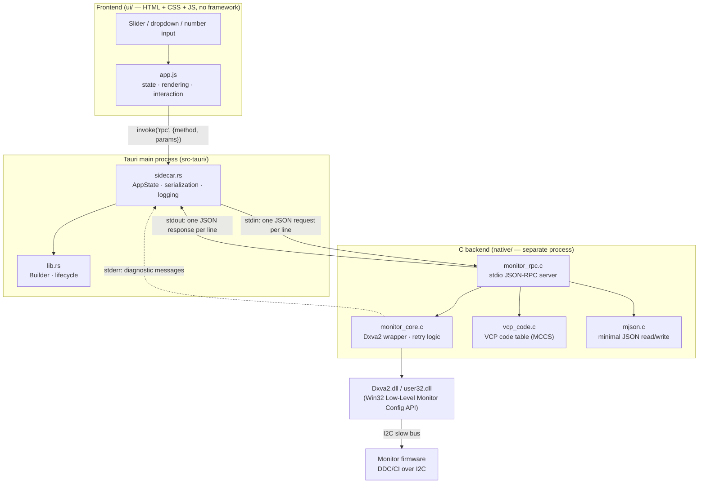

# MonitorCtrl

**简体中文版 (Simplified Chinese): [README.zh-CN.md](README.zh-CN.md)**

A Windows monitor control tool rewritten with **Tauri 2 + C**. It reads and writes hardware parameters of your monitor — brightness, contrast, color, input source, etc. — directly over the DDC/CI (VESA MCCS) protocol. It lives in the system tray: left-click the tray icon for a quick panel to adjust brightness / switch input source / power the display off.

The original project [`dot-osk/monitor_ctrl`](https://github.com/dot-osk/monitor_ctrl) was Python + tkinter; this repository is a complete port to a **native C backend + modern Web frontend** desktop application.

> **Download**: prebuilt [NSIS](https://nsis.sourceforge.io/) installer (about 1.5 MB) is available on the [Releases](https://github.com/TongenShen/monitor-ctrl-tauri/releases/latest) page — double-click to install.

---

## Table of Contents

- [Quick Start](#quick-start)
- [Why This Layering](#why-this-layering)
- [Architecture](#architecture)
- [Mapping from the Original Project](#mapping-from-the-original-project)
- [Feature List](#feature-list)
- [Build Prerequisites](#build-prerequisites)
- [Build & Run](#build--run)
- [JSON-RPC Protocol Reference](#json-rpc-protocol-reference)
- [Two Hardware Pitfalls (Important)](#two-hardware-pitfalls-important)
- [FAQ](#faq)
- [Directory Structure](#directory-structure)
- [Current Status](#current-status)
- [License](#license)

---

## Quick Start

### End users (install directly)

1. Grab the installer `MonitorCtrl_1.3.0_x64-setup.exe`
   (at `src-tauri/target/release/bundle/nsis/`, about 1.5 MB)
2. Double-click to install — installs for the current user
3. Launch "MonitorCtrl"

**Requirements**: Windows 10 1809+ or Windows 11, with the WebView2 Runtime installed
(WebView2 ships with Windows 11 and newer Windows 10 builds; the installer downloads it automatically if missing).

### Developers (run from source)

```powershell
cd monitor-ctrl-tauri
cd native; .\build.bat; cd ..   # 1) compile the C backend
npm install                     # 2) install the Tauri CLI
npm run dev                     # 3) start in dev mode
```

> ⚠️ **Known issue**: `npm run dev` may not show the frontend window in some environments
> (the sidecar backend starts, but the WebView window does not appear). Building the NSIS installer
> with `npm run build` and testing that is recommended instead.

See [Build & Run](#build--run) for the full workflow.

### Prerequisites (both are easy to miss)

- **External monitors only**. Laptop built-in panels, virtual displays, and some KVM switches /
  video capture cards do not pass DDC/CI through, so they are reported as "unsupported".
- **DDC/CI must be enabled in the monitor's OSD menu** — many monitors ship with it off by default,
  in which case every property reads back as unsupported.

---

## Why This Layering

| Decision | Rationale |
| --- | --- |
| **C as the backend** | DDC/CI ultimately calls the Win32 API in `Dxva2.dll`. C just `#include`s the header and links it — zero runtime dependencies, single 92 KB file |
| **Tauri instead of Electron** | Reuses the system WebView2; installer is ~3 MB instead of ~150 MB, memory footprint an order of magnitude lower |
| **Backend as a sidecar child process** | See below |
| **stdio + line-delimited JSON as IPC** | See below |

### Why a separate backend process

1. **DDC/CI is a slow I2C bus and must be serialized.**
   A single read/write takes tens to hundreds of milliseconds. If commands are issued concurrently,
   the monitor firmware returns checksum errors or stops responding altogether.
   stdin/stdout is naturally a **single-channel serial queue** — only one request in flight at a time,
   no locks needed, no race conditions.

2. **Crash isolation.**
   Monitor drivers run in kernel mode; certain KVM / capture cards / virtual displays can hang or
   misbehave inside `Dxva2` calls. Running in a child process means a crash only drops the backend —
   the frontend can show a "retry" button and restart it, instead of losing the whole app.

3. **Avoids FFI ownership issues.**
   If the C code were compiled to a `.dll` and called from Rust via `extern "C"`, you would have to
   manually manage memory ownership, string lifetimes, error-code conversion, and risk ABI mismatch.
   Through pipes, the C side only needs to read/write text lines and the Rust side only needs to send
   JSON — a very clean boundary.

4. **No ports, no firewall prompts, no network exposure.**
   Not a local socket and not HTTP — just a pair of anonymous pipes between parent and child.

> **Cost**: the frontend cannot touch hardware directly; every operation goes through one round of
> JSON serialization. For UI interactions a few times per second, this is imperceptible.

---

## Architecture



**Data flow**: user drags a slider → `app.js` calls `invoke` **once on release** → Rust writes the
request into the child's stdin → C parses it and calls `Dxva2` → the monitor responds → C writes the
result to stdout → Rust reads one line and returns it to the frontend → the UI updates.

**stderr is for logging only** — it is forwarded by the Rust side and tagged with a `[monitor_rpc]`
prefix; it never mixes into the JSON stream.

---

## Mapping from the Original Project

| Original `monitor_ctrl` (Python) | This project | Notes |
| --- | --- | --- |
| `vcp.py` → `class PhyMonitor` | `native/monitor_core.c` + `.h` | Dxva2 calls, caps parsing, property read/write |
| `vcp_code.py` (VCP code table) | `native/vcp_code.c` + `.h` | MCCS code table + enum tables + name lookup |
| `tkui.py` (tkinter/ttk) | `ui/index.html` + `style.css` + `app.js` | Brand-new dark UI, no framework |
| `monitor_ctrl.py` (argparse CLI) | `native/monitor_rpc.c` (JSON-RPC) | CLI replaced with an inter-process protocol |
| In-process `setattr` calls | **New** Rust sidecar layer | Cross-process serialization + crash isolation |
| — | `native/mjson.c` | Hand-written minimal JSON library, avoids pulling in cJSON |

---

## Feature List

### Read (`get_props`)

| Property | VCP code | Description |
| --- | --- | --- |
| `brightness` / `brightness_max` | `0x10` | Brightness |
| `contrast` / `contrast_max` | `0x12` | Contrast |
| `rgb_gain` / `rgb_gain_max` | `0x16/0x18/0x1A` | RGB channel gains |
| `color_temperature` | `0x0C` | Color temperature (Kelvin), computed as `3000 + current value × step` |
| `color_preset` | `0x14` | Color preset (sRGB / 4000K / 6500K / User Mode…) |
| `osd_language` | `0xCC` | OSD menu language |
| `power_mode` | `0xD6` | Power mode (on / off) |
| `input_src` | `0x60` | Input source (DisplayPort 2 / HDMI 1…) |

Any field a monitor does not support returns JSON `null`, and the corresponding enum list returns `[]`;
the frontend degrades gracefully (disables the control and shows a hint).

### Read (`get_info`)

`model` · `description` · `display_type` · `poweron_hours` (`0xC0` cumulative power-on time) ·
`panel_type` (`0xB2` pixel arrangement) · `caps` (full DDC/CI capability string)

### Write (`set_prop`)

Brightness, contrast, RGB gain (all three channels in one call), color temperature, color preset,
OSD language, power mode, input source — plus a generic escape hatch `vcp:<VCP name>` that writes
any VCP code.

> **EEPROM protection**: the frontend compares against the current value before committing and
> **does not issue the write if nothing changed**. Color presets and OSD language are stored in the
> monitor's EEPROM; repeated writes wear it out. This check is inherited from the original Python version.

### Actions (`action`)

- `auto_setup` — Auto Setup (maps to `0x1E`)
- `reset_factory` — factory reset (maps to `0x04`; the frontend shows a confirmation dialog first)

### System Tray

- **Clicking the window × does not quit** — it minimizes to the system tray (the backend stays
  resident; reopening is instant)
- **Left-click the tray icon**: pops up a quick panel (brightness slider / input source selector /
  power off)
- **Right-click the tray icon**: menu with "Show main window" and "Exit"
- The quick panel auto-hides when it loses focus and is positioned above the tray, 12 px clear of the taskbar

### Misc

- Multi-monitor enumeration and switching (sidebar list)
- Operation log (all write operations are recorded with timestamp and success/failure)
- Backend status indicator + one-click backend restart
- Re-enumerate monitors after hot-plug (F5)
- End-to-end UTF-8: Chinese monitor descriptions / caps strings never get garbled
- Backend console window fully hidden (`CREATE_NO_WINDOW`, no visual glitch)

---

## Build Prerequisites

| Dependency | Version | Purpose | Notes |
| --- | --- | --- | --- |
| **MinGW-w64 GCC** | 16.x | Compiles the C backend | Ships `libdxva2.a` and Dxva2 headers — **no Windows SDK needed** |
| **Rust** (rustup) | 1.77+ | Compiles the Tauri main process | Needs the `x86_64-pc-windows-msvc` target |
| **MSVC Build Tools** | VS 2019+ | Linker for Rust | Install the "Desktop development with C++" workload |
| **Node.js** | 18+ | Frontend build / Tauri CLI | Toolchain only; not a runtime dependency |
| **WebView2 Runtime** | any | Tauri rendering | Built into Windows 11 and newer Windows 10 |
| Python 3 | 3.x | Only for icon generation / test scripts | Optional |

> The C backend does **not** depend on MSVC — MinGW alone builds `monitor_rpc.exe`.
> MSVC only serves as the linker for Rust.

---

## Build & Run

```powershell
cd monitor_ctrl_tauri

# 1) compile the C backend (produces native/monitor_rpc.exe)
cd native; .\build.bat; cd ..

# 2) install the frontend toolchain
npm install

# 3) copy the exe under its target-triple-suffixed name (Tauri externalBin requirement)
npm run sidecar

# 4) run in dev mode (runs sidecar first, then tauri dev)
npm run dev

# 5) package into an NSIS installer (produces src-tauri/target/release/bundle/nsis/*.exe)
npm run build
```

`package.json` scripts:

| Script | Actual command |
| --- | --- |
| `npm run native` | `cd native && build.bat` |
| `npm run sidecar` | `node scripts/stage-sidecar.mjs` |
| `npm run dev` | `npm run sidecar && tauri dev` |
| `npm run build` | `npm run sidecar && tauri build` |

### Testing the C backend standalone

The backend has no frontend dependency and can be smoke-tested on its own:

```powershell
cd native
python test_rpc.py            # automated tests: ping / enumeration / read props / edge cases
python test_rpc.py --write    # additionally tests one brightness write round-trip
python test_rpc.py -i         # interactive mode, type JSON requests by hand
```

### Regenerating the icon

```powershell
python scripts\make-icon.py   # pure stdlib (os/struct/zlib), no Pillow required
```

---

## JSON-RPC Protocol Reference

**Transport**: one JSON object per line. Requests go to stdin, responses are read from stdout.
**Encoding**: UTF-8, `\n` line endings (both sides force binary mode; no CRLF conversion).
**Logging**: everything goes to stderr.

### Request format

```json
{"id": 1, "method": "get_props", "index": 0}
```

### Response format

```json
{"id": 1, "ok": true, "result": { ... }}
{"id": 1, "ok": false, "error": "failed to read VCP 0x10"}
```

`id` is incremented by the client and echoed back verbatim by the server. The client validates that
the id matches.

### Methods

#### `ping`

```json
→ {"id":1,"method":"ping"}
← {"id":1,"ok":true,"result":{"pong":"1"}}
```

#### `list_monitors`

```json
→ {"id":2,"method":"list_monitors"}
← {"id":2,"ok":true,"result":{"monitors":[
     {"index":0,"model":"Generic PnP Monitor","description":"Generic PnP Monitor"}
   ]}}
```

#### `get_props`

```json
→ {"id":3,"method":"get_props","index":0}
← {"id":3,"ok":true,"result":{
     "brightness": 60,
     "brightness_max": 100,
     "contrast": 75,
     "contrast_max": 100,
     "rgb_gain": [50, 50, 50],
     "rgb_gain_max": 100,
     "color_temperature": 3050,
     "color_preset": "6500K",
     "color_preset_list": ["sRGB","Display Native","4000K","5000K","6500K","7500K","9300K","User Mode 1","User Mode 2","User Mode 3"],
     "osd_language": "Chinese-simplified",
     "osd_languages_list": ["English","Chinese-simplified","Chinese-traditional","French","German","Italian","Japanese","Korean","Russian","Spanish"],
     "power_mode": "on",
     "power_mode_list": ["on","off"],
     "input_src": "DisplayPort 2",
     "input_src_list": ["Analog video (R/G/B) 1","Analog video (R/G/B) 2","Digital video (TMDS) 1","Digital video (TMDS) 2","Composite video 1","Composite video 2","S-Video 1","S-Video 2","DisplayPort 1","DisplayPort 2","HDMI 1","HDMI 2"]
   }}
```

Unsupported properties are `null`; unsupported lists are `[]`.

#### `get_info`

```json
→ {"id":4,"method":"get_info","index":0}
← {"id":4,"ok":true,"result":{
     "model": "Generic PnP Monitor",
     "description": "Generic PnP Monitor",
     "display_type": "lcd",
     "poweron_hours": 866,
     "panel_type": "Red / Green / Blue vertical stripe",
     "caps": "prot(monitor)type(lcd)MStarcmds(01 02 03 07 0C E3 F3)vcp(02 04 05 08 10 12 14(04 05 08 0B) 16 18 1A 52 60( 11 12 0F 10) 62 AA(01 02) AC AE B2 B6 C6 C8 C9 D6(01 04 05)CC(02 0D) DF FD)mccs_ver(2.1)mswhql(1)"
   }}
```

#### `enum_tables`

Fetches all enum tables in one shot, avoiding per-field requests:

```json
→ {"id":5,"method":"enum_tables","index":0}
← {"id":5,"ok":true,"result":{
     "color_preset_list": [...],
     "osd_languages_list": [...],
     "power_mode_list": [...],
     "input_src_list": [...]
   }}
```

**`index` filters the results against that monitor's caps string** — see the next section.

#### Filtering enum tables by caps string (important)

The original `monitor_ctrl.py` / `tkui.py` stuffed the **entire** VESA MCCS universe into the
dropdowns: 18 input sources (Tuner / Composite / S-Video included), 38 OSD languages, 13 color
presets. But a real monitor only implements a subset of those — picking "HDMI 1" from the list was a
guaranteed error.

The correct approach is to parse the caps string the monitor reports itself. Its `vcp(...)` section
looks like:

```
vcp(02 04 05 08 10 12 14(04 05 08 0B) 16 18 1A 52 60( 11 12 0F 10) 62 AA(01 02) ... D6(01 04 05)CC(02 0D) DF FD)
```

The rules:

| Shape in caps | Meaning | Handling in this project |
| --- | --- | --- |
| `14(04 05 08 0B)` | VCP 0x14 supported, values limited to 0x04 / 0x05 / 0x08 / 0x0B | Keep only those 4 |
| `16` | VCP 0x16 supported, values not restricted | Keep the full list |
| VCP code not found at all | Not supported | Return `[]`, frontend disables the control |
| Monitor off / caps unavailable | Cannot tell | Fall back to the full list (keeps the UI renderable) |

Filtered result on the author's machine:

| Table | Full list | After filtering |
| --- | --- | --- |
| Input source (`0x60`) | 18 items | `DisplayPort 1` / `DisplayPort 2` / `HDMI 1` / `HDMI 2` |
| OSD language (`0xCC`) | 38 items | `English` / `Chinese-simplified` |
| Color preset (`0x14`) | 13 items | `5000K` / `6500K` / `9300K` / `User Mode 1` |
| Power mode (`0xD6`) | 2 items | `on` / `off` |

The parsing lives in `caps_find_vcp_values()` in `monitor_core.c` and has two easy-to-miss traps:

1. **An enum table may sit flush against the previous VCP's closing paren, with no space in between**:
   in `D6(01 04 05)CC(02 0D)`, the `CC` is preceded by `)`, not a space. So the leading-char check must
   accept more than just space and `(`.
2. **Do not use `strstr` to compare two-digit hex values**:
   searching for `"20"` inside `"020D"` hits the 2nd character, falsely marking `Serbian` (0x20) as
   supported. Pairs must be compared on a 2-character aligned basis.

Also, the search must be confined to the `vcp(...)` section (find its closing paren by bracket
matching), otherwise `02` / `0C` in `cmds(01 02 03 07 0C E3 F3)` get falsely matched too.

> The `get_props` response **already embeds** these 4 filtered lists, so rendering the control panel
> needs only one `get_props` call — no separate `enum_tables` round trip.

#### `set_prop`

```json
→ {"id":6,"method":"set_prop","index":0,"prop":"brightness","value":80}
← {"id":6,"ok":true,"result":{"prop":"brightness","status":"ok"}}
```

`prop` → `value` types:

| `prop` | `value` type | Example |
| --- | --- | --- |
| `brightness` / `contrast` / `color_temperature` | integer | `80` / `4200` |
| `rgb_gain` | array of 3 integers | `[60,55,50]` |
| `color_preset` / `osd_language` / `power_mode` / `input_src` | string | `"6500K"` |
| `vcp:<VCP name>` | integer | `"vcp:Luminance"` → `80` |

The `vcp:` prefix is the generic escape hatch — you can write any VCP name from the code table
(e.g. `vcp:Restore Factory Defaults`).

#### `action`

```json
→ {"id":7,"method":"action","index":0,"action":"auto_setup"}
← {"id":7,"ok":true,"result":{"action":"auto_setup","status":"ok"}}
```

`action` values: `auto_setup` | `reset_factory`

#### `shutdown`

```json
→ {"id":8,"method":"shutdown"}
← {"id":8,"ok":true,"result":{"status":"bye"}}
```

### Tauri commands (frontend → Rust)

The frontend calls these via `invoke()`; they translate into the JSON-RPC above:

| Command | Arguments | Returns |
| --- | --- | --- |
| `rpc` | `{method, params}` | backend `result` object |
| `rpc_batch` | `{calls: [{key, method, params}]}` | `{key: {ok, result \| error}}` |
| `enum_tables` | `{index}` | combined enum tables (already caps-filtered) |
| `backend_status` | — | `{running: bool}` |
| `restart_backend` | — | path of the new backend exe |
| `get_log` | — | `[{time, level, message}]` |
| `clear_log` | — | `null` |

**`AppState::rpc` holds the mutex for the entire call** — that is where the DDC/CI serialization guarantee lives.

### Error codes (C-side `MonResult`)

| Value | Name | Meaning |
| --- | --- | --- |
| 0 | `MON_OK` | Success |
| -1 | `MON_ERR_ARG` | Invalid argument |
| -2 | `MON_ERR_NO_MONITOR` | No monitor found at that index |
| -3 | `MON_ERR_OPEN` | Failed to open the physical monitor handle |
| -4 | `MON_ERR_CAPS` | Failed to read the capability string |
| -5 | `MON_ERR_VCP` | VCP read/write failed (usually an I2C checksum error) |
| -6 | `MON_ERR_RANGE` | Value out of range |
| -7 | `MON_ERR_UNSUPPORTED` | The monitor does not support this feature |
| -8 | `MON_ERR_NOMEM` | Out of memory |

The frontend's `friendlyError()` translates `MON_ERR_*` into friendly Chinese messages.

---

## Two Hardware Pitfalls (Important)

### 1. `hPhysicalMonitor` may be `0`, and DDC/CI still works

On the author's machine, the `PHYSICAL_MONITOR.hPhysicalMonitor` returned by
`GetPhysicalMonitorsFromHMONITOR` is literally `0`. If you intuitively write
`if (handle == NULL) return ERROR;`, you will falsely conclude "monitor cannot be opened" and every
property reads back as `null`.

Even more counterintuitive: `GetCapabilitiesStringLength(NULL, &len)` **succeeds**.

> **Conclusion**: never use `hPhysicalMonitor == 0` to judge validity. The original Python version
> never checked this value, and it was right.
> In this project all `handle != NULL` checks in `mon_send_vcp` / `mon_read_vcp` have been removed,
> and `mon_close()` unconditionally calls `DestroyPhysicalMonitor` (passing 0 is a safe no-op).

### 2. DDC/CI I2C reads **naturally fail intermittently**

Measured on the original Python version: reading the caps 8 consecutive times, **only 7 succeeded**;
on failure it raised `OSError [WinError -1071241845]` (a checksum error).

This is not a bug — it is a physical property of the I2C bus. Slow firmware response, timing jitter,
and bus noise all cause checksum failures.

> **Conclusion**: retry every single transaction. This project adds, in `monitor_core.c`:
> ```c
> #define MON_RETRY_TIMES   3
> #define MON_RETRY_DELAY_MS 15
> ```
> `mon_send_vcp` / `mon_read_vcp` and both caps calls are wrapped in retry loops.
> **Measured result: 5 consecutive runs, all succeeded** — more stable than the original Python version.

---

## FAQ

**Q: "No monitor detected" or every property is empty**

Check in order:

1. Look for `DDC/CI` or `DDC/CI Support` in the monitor's OSD menu and make sure it is **On**. This is the most common cause.
2. Try a different cable or port — some cheap HDMI adapters carry video only and do not pass the DDC/CI I2C channel through.
3. Is there a KVM / switch / capture card in between? These often cut DDC/CI entirely.
4. Laptop built-in panels are not supported; an external monitor is required.
5. Click the refresh button in the title bar and retry — intermittent I2C failures are common (see hardware pitfall 2 above).

**Q: "Failed to read the monitor capability string (DDC/CI communication unstable, retry)"**

Same as item 5 above. It is an I2C checksum failure; clicking "retry" usually passes on the first try. The backend already retries 3 times internally and only reports after all attempts fail.

**Q: Backend status shows "Not connected"**

The C backend child process did not start. Click the status dot or press F5 to restart the backend.
If it keeps failing, the installation is incomplete — `monitor_rpc.exe` should sit next to the main
executable in the install directory.

**Q: An option is missing from my dropdown**

That is **intentional**. The project parses the monitor's reported caps string and only lists values
it actually declares support for (see [Filtering enum tables by caps string](#filtering-enum-tables-by-caps-string-important)).
If your monitor genuinely supports a value it does not declare in caps, that is a firmware issue —
you can force it through the `vcp:<VCP name>` escape hatch of `set_prop`.

**Q: Why doesn't the picture follow the slider while I drag it?**

By design. A single DDC/CI read/write takes tens to hundreds of milliseconds; firing commands
continuously while dragging would saturate the I2C bus and the firmware would start returning
checksum errors. So the write happens **once, on pointerup**. The number tracks the slider in real
time, but the hardware only changes on release.

**Q: Can this wear out my monitor?**

Color presets and OSD language live in the monitor's EEPROM; repeated writes wear it out. So the
frontend compares against the current value before committing and **skips the write if nothing
changed**. This protection is inherited from the original Python version.

**Q: Does it support laptop built-in panels / virtual displays?**

No. The Dxva2 Low-Level Monitor Configuration API can only operate physical monitors that speak
DDC/CI.

**Q: Why is the packaged exe so small (1.5 MB)?**

Because it reuses the system WebView2 instead of shipping an entire Chromium like Electron does.

---

## Directory Structure

```
monitor_ctrl_tauri/
├── native/                     # C backend (standalone executable)
│   ├── monitor_rpc.c           #   stdio JSON-RPC server (main)
│   ├── monitor_core.c/.h       #   Dxva2 wrapper + retry logic
│   ├── vcp_code.c/.h           #   VESA MCCS VCP code table
│   ├── mjson.c/.h              #   minimal JSON read/write
│   ├── test_rpc.py             #   smoke tests / interactive debugging
│   └── build.bat               #   MinGW build script
├── src-tauri/                  # Tauri main process (Rust)
│   ├── src/
│   │   ├── lib.rs              #   Builder / lifecycle / command registration
│   │   ├── main.rs             #   entry point (console hidden in release)
│   │   └── sidecar.rs          #   child-process management / serialization / logging
│   ├── capabilities/default.json
│   ├── icons/icon.ico
│   ├── build.rs                #   injects the target triple + Windows manifest
│   ├── app.manifest            #   Windows app manifest (UAC level)
│   ├── Cargo.toml
│   └── tauri.conf.json
├── ui/                         # frontend (no framework)
│   ├── index.html              #   main interface
│   ├── popup.html              #   tray quick panel
│   ├── popup.js                #   quick-panel logic
│   ├── style.css               #   design tokens + dark/light themes
│   └── app.js                  #   main-interface state / rendering / interaction
├── scripts/
│   ├── stage-sidecar.mjs       #   copies the exe under a triple-suffixed name
│   └── make-icon.py            #   programmatically generates icon.ico (pure stdlib)
├── package.json
├── README.md                   #   this file (English)
├── README.zh-CN.md             #   README in Simplified Chinese
├── LICENSE                     #   MIT
├── .gitattributes
└── .gitignore
```

**Artifacts** (after a build):

| Artifact | Path |
| --- | --- |
| C backend | `native/monitor_rpc.exe` (~93 KB) |
| Dev main program | `src-tauri/target/debug/monitor-ctrl-tauri.exe` |
| Release main program | `src-tauri/target/release/monitor-ctrl-tauri.exe` (~4.6 MB) |
| **NSIS installer** | `src-tauri/target/release/bundle/nsis/MonitorCtrl_1.3.0_x64-setup.exe` (~1.5 MB) |

---

## Current Status

| Item | Status |
| --- | --- |
| C backend (5 modules) | ✅ compiles with zero warnings |
| Hardware-tested (brightness/contrast/RGB/temp/preset/language/power/input) | ✅ all consistent with the original Python version |
| DDC/CI stability | ✅ 5 consecutive runs all succeeded (original: 7/8) |
| caps-string enum filtering | ✅ end-to-end (C → Rust → frontend) |
| Smoke test `test_rpc.py` | ✅ all green (incl. edge cases) |
| Tauri app compile / launch | ✅ |
| Backend console hidden | ✅ CREATE_NO_WINDOW, no console window |
| System tray resident | ✅ minimize-to-tray / left-click popup / right-click menu + quit |
| Tray quick panel | ✅ brightness / input source / power off |
| UI visual verification | ✅ confirmed via screenshots |
| NSIS installer | ✅ 1.5 MB |
| Documentation | ✅ this file |

---

## License

[MIT](LICENSE).

The C backend and frontend logic are ported from the Python/tkinter
[`dot-osk/monitor_ctrl`](https://github.com/dot-osk/monitor_ctrl)
(Copyright (c) 2018 Miguel X), under its MIT license terms.
